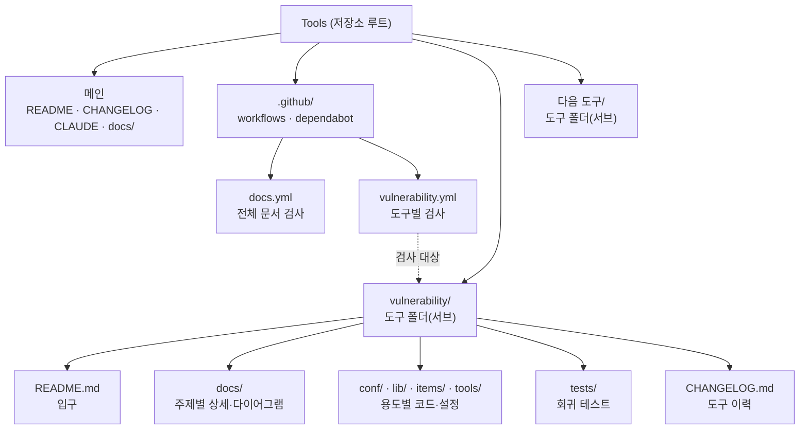

# 저장소 구조

도구마다 폴더 하나를 쓰고, 정보는 메인(저장소 공통)과 서브(도구별)로 나눠 담음.

## 구조도

## 메인과 서브

| 구분 | 위치 | 담는 내용 | 읽는 사람 |
| --- | --- | --- | --- |
| 메인 | [README.md](../README.md), [docs/](.) | 도구 목록, 저장소 구조, 작업 흐름, 공통 표준 | 저장소를 처음 보는 사람 |
| 서브 | `<도구>/README.md`, `<도구>/docs/` | 그 도구의 사용법, 내부 구조, 다이어그램, 항목표 | 그 도구를 쓰거나 고치는 사람 |

- 한 도구에만 해당하는 내용은 서브에 둠.
- 둘 이상의 도구에 공통인 내용만 메인에 둠.
- 서브 내용은 메인에 복사하지 않고 링크로 연결함.

## 경로별 역할

| 경로 | 역할 |
| --- | --- |
| [README.md](../README.md) | 입구. 도구 목록 표와 문서 링크 |
| [CHANGELOG.md](../CHANGELOG.md) | 저장소 수준 변경 이력(구조·CI·표준). 도구 변경은 도구의 CHANGELOG |
| [CLAUDE.md](../CLAUDE.md) | Claude Code 작업 규칙 |
| [docs/](.) | 저장소 공통 문서(메인) |
| [.github/workflows/](../.github/workflows) | 워크플로. 공통은 `docs.yml`, 도구별은 `<도구>.yml` |
| [.github/dependabot.yml](../.github/dependabot.yml) | 액션 버전 갱신 알림(월 1회) |
| [.markdownlint.jsonc](../.markdownlint.jsonc) | 문서 검사 설정 |
| [.gitignore](../.gitignore) | 비밀 파일·OS 잡파일 제외 |
| [vulnerability/](../vulnerability/README.md) | 도구 폴더(서브) |

## 도구 폴더 규약

| 파일 | 필수 여부 | 내용 |
| --- | --- | --- |
| `README.md` | 필수 | 입구. 120줄 이하. 무엇인지, 빠른 시작, 상세 문서 링크 |
| `CHANGELOG.md` | 필수 | 도구별 버전 이력 |
| `docs/` | README가 120줄을 넘으면 필수 | 주제별 상세 문서와 다이어그램(mermaid) |
| `tests/` | 실행 코드가 있으면 필수 | 회귀 테스트. 도구 워크플로가 실행함 |
| `conf/` | 설정 파일이 있으면 | 비밀 값은 비워 두고 커밋함 |
| `lib/` | 공통 코드·자료가 있으면 | 여러 스크립트가 읽는 함수·표 |
| `items/` | 항목 단위로 나뉘면 | 항목별 구현. 직접 실행도 가능 |
| `tools/` | 보조 스크립트가 있으면 | 배포 묶음, 번들 생성 등 |

실행 파일은 도구 폴더 바로 아래에 두고, 나머지는 위 용도별 폴더에 둠. vulnerability가 이 구성을 쓰며 이유는 [내부 구조](../vulnerability/docs/architecture.md) 참고.

## 이름 규칙

| 대상 | 규칙 | 예 |
| --- | --- | --- |
| 도구 폴더 | 소문자 영문, 하이픈, 하는 일이 드러나는 이름 | `vulnerability` |
| 워크플로 파일과 이름 | 도구 폴더 이름과 같게 | `.github/workflows/vulnerability.yml` |
| 커밋 scope | 도구 폴더 이름 | `fix(vulnerability): ...` |
| 분류 | 루트 README 도구 목록의 분류 열에 적음. 값은 자유 | 보안, 운영, 개발 |
