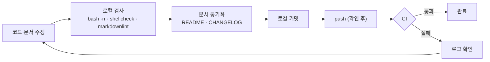

# 작업 흐름

변경이 로컬 검사를 거쳐 CI까지 가는 길과, 새 도구를 추가하는 절차를 정리함.

## 변경 흐름

## CI 구조

| 워크플로 | 실행 조건(경로) | 검사 내용 |
| --- | --- | --- |
| [docs.yml](../.github/workflows/docs.yml) | `**/*.md`, `.markdownlint.jsonc` 변경 | 저장소 전체 markdownlint |
| [vulnerability.yml](../.github/workflows/vulnerability.yml) | `vulnerability/**` 변경 | `bash -n`, `shellcheck`, 회귀 테스트(root), libwrap 링크 확인(참고) |

- 러너는 모두 `ubuntu-24.04`. 대상 서버와 같은 환경임.
- push는 `main`만, 브랜치 작업은 PR 이벤트로만 실행함.
- 워크플로마다 `concurrency`, `timeout-minutes`, 경로 필터를 둠. 비공개 저장소의 월 2,000분 한도를 지키기 위함.
- 도구별 워크플로는 해당 폴더가 바뀔 때만 돎. 도구가 늘어도 서로의 검사에 영향이 없음.

## 로컬 검사

| 검사 | 명령 | 맥에서 실행 |
| --- | --- | --- |
| 문서 | `npx markdownlint-cli2@latest "**/*.md"` | 가능 |
| 셸 문법 | `bash -n <파일>` | 가능 |
| 셸 정적 분석 | 도구 폴더에서 `shellcheck -S warning <파일>` | 가능 |
| 회귀 테스트 | CI에서만 실행 | 불가(Ubuntu root 필요) |

## 새 도구 추가 절차

1. 도구 폴더를 만들고 `README.md`(입구)와 `CHANGELOG.md`를 씀. 규약은 [저장소 구조](structure.md#도구-폴더-규약) 참고.
2. 코드와 `tests/`를 추가함.
3. `.github/workflows/<도구>.yml`을 만듦. [vulnerability.yml](../.github/workflows/vulnerability.yml)의 경로 필터·`concurrency`·`timeout-minutes`를 따름.
4. 루트 [README.md](../README.md) 도구 목록 표에 한 줄을 추가함.
5. 루트 [CHANGELOG.md](../CHANGELOG.md)의 `[Unreleased]`에 추가 내역을 씀.
6. 로컬 검사 후 커밋하고, push한 뒤 `gh run watch <실행ID> --exit-status`로 CI 결과를 확인함.

## 릴리즈

아직 정하지 않음. 도구별 버전은 각 도구의 CHANGELOG에 적고 있으며, 태그 규칙은 정해지면 이 문서에 추가함.
