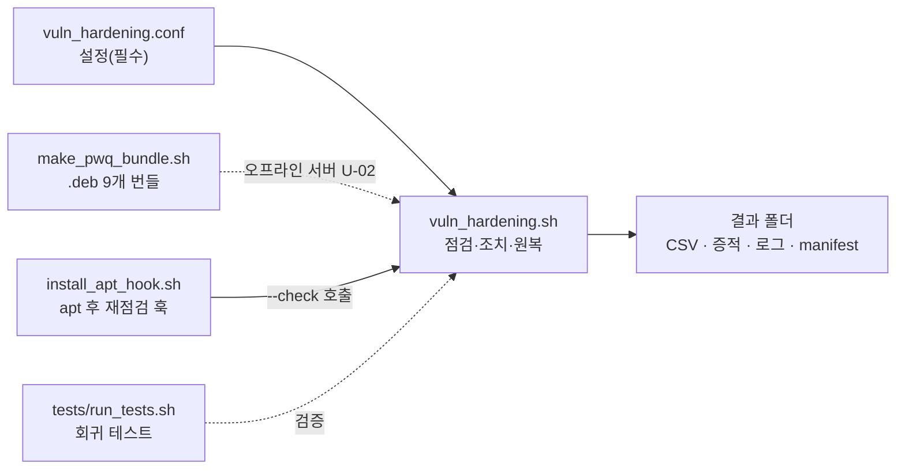
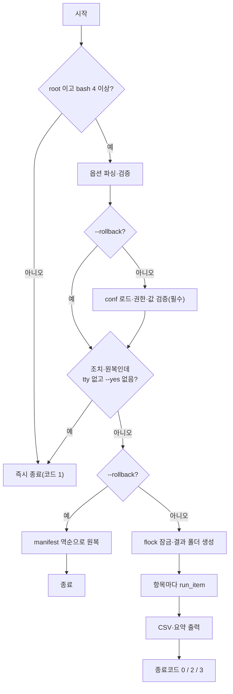
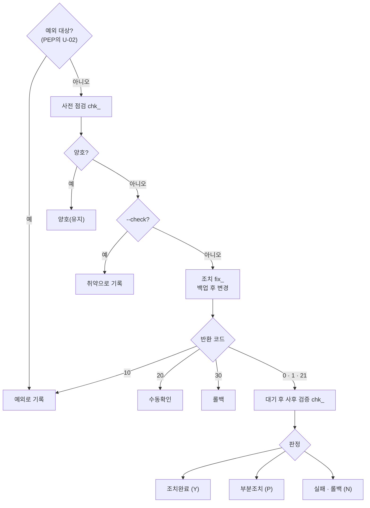
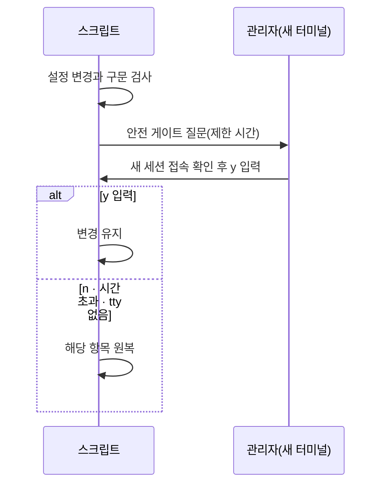

# vulnerability 내부 구조

스크립트가 어떤 파일로 이뤄지고 어떤 순서로 움직이는지 그림으로 정리함. 사용법과 항목별 조치 내용은 [README](../README.md) 참고.

## 파일 구성

## 실행 흐름

원복(`--rollback`)은 conf가 없거나 깨져도 복구할 수 있도록 conf를 읽지 않음.

## 항목 처리 흐름

| 반환 코드 | 의미 | 결과 |
| --- | --- | --- |
| 0 | 조치 성공 | 사후 검증이 양호면 조치완료 |
| 1 | 조치 중 오류 | 스스로 원복했으면 롤백, 아니면 실패 |
| 10 | 예외 | 예외 |
| 20 | 입력값 부족 등 사람 판단 필요 | 수동확인 |
| 21 | 일부만 조치 | 부분조치 |
| 30 | 안전 게이트 미승인 | 롤백 |

## 안전 게이트

SSH·PAM·방화벽을 바꾸는 U-01, U-03, U-28에 적용됨.

`--yes`를 주면 게이트가 자동 승인되고, 최종 요약에 자동 승인된 항목이 표시됨.

## 원복 구조

조치 중 변경을 `manifest`에 한 줄씩 기록하고, 원복할 때 아래에서 위로 처리함.

| 기록 종류 | 원복 동작 |
| --- | --- |
| `FILE` | 백업 파일 복원, 원래 없던 파일은 삭제 |
| `MODE` | 소유자와 권한 복원 |
| `STATOVR` | `dpkg-statoverride` 이전 상태 복원 |
| `SVC` | 서비스의 enable·active 상태 복원 |
| `CHAGE` | 계정의 비밀번호 사용기간 값 복원 |
| `CMD` | 기록해 둔 되돌리기 명령 실행 |
| `ROLLEDBACK` | 원복 완료 표식. 이 표식이 있는 항목은 다시 원복하지 않음 |

전체 원복이 끝나면 모든 항목에 `ROLLEDBACK`이 남아, 같은 `rollback.sh`를 다시 실행해도 이후 변경을 덮어쓰지 않음.

## 결과물 구조

`/root/n2sf_hardening/<호스트>_<일시>/` 아래에 생김. 점검만 한 경우 폴더 이름 끝에 `_check`가 붙음.

| 경로 | 내용 | 조치 모드에만 생김 |
| --- | --- | --- |
| `result_<호스트>.csv` | 조치 전·후, 결과, 조치결과(Y/P/N) | 아니오 |
| `evidence/` | 항목별 증적 | 아니오 |
| `run.log` | 실행 로그 | 아니오 |
| `manifest` | 원복용 변경 기록 | 아니오 |
| `files/<항목>/` | 변경 전 파일 백업 | 아니오(변경이 있을 때) |
| `rollback.sh` | 전체 원복 실행 파일 | 예 |
| 스크립트·conf 사본 | 실행 당시 버전 보관 | 예 |
